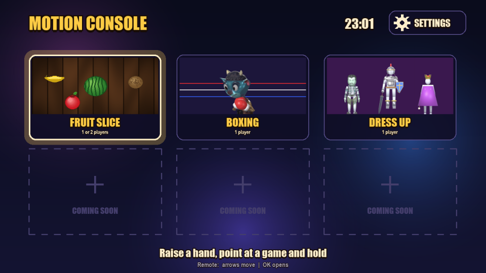
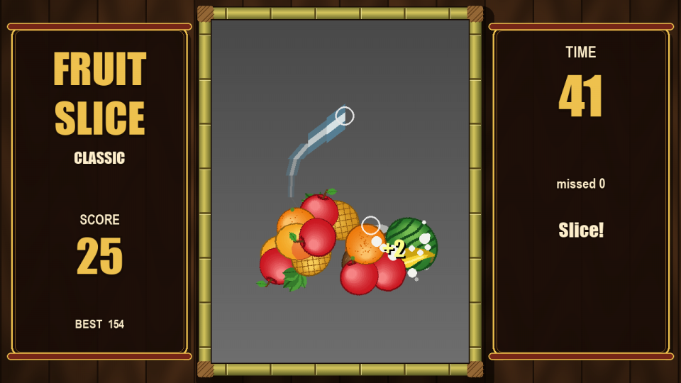
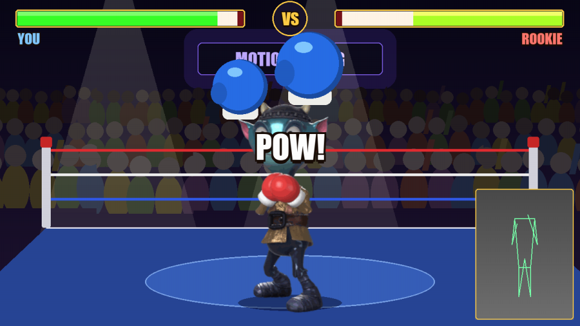
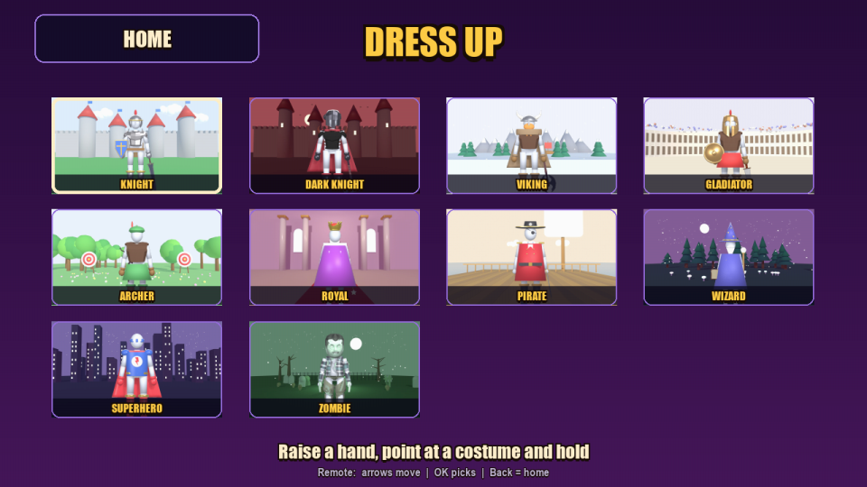

# Motion Console

A do-it-yourself **camera motion-game console**: a phone (or webcam) watches the player, an AI pose
model tracks their body, and games on the TV react to their movement. No controllers, no keyboard:
you pick games by raising a hand and pointing.

Inspired by the Nex Playground. Built for kids, runs on a small PC under the TV, written in Python.



| Fruit Slice | Boxing | Dress Up |
| --- | --- | --- |
|  |  |  |

## The games

- **Fruit Slice:** swipe your hands through flying fruit. *Classic* (60 seconds) or *Survival*
  (bombs cost a life, 5 lives). **1 or 2 players** (BLUE vs ORANGE, each with their own score).
- **Boxing:** first person against a computer boxer (Rookie, Contender, Champ). Punch by straightening
  your arm; when the boxer's glove glows, cover your face with both gloves or lean/duck out of the way.
- **Dress Up:** a magic mirror. Pick one of 10 costumes (knight, wizard, viking, superhero, ...) and it
  follows your body on screen.

Everything works three ways: **hands** (raise a hand, point at a button, hold), a **mouse**, or a
**TV-style remote** (arrow keys + OK, for example a USB air-mouse remote).

## What you need

| Part | Notes |
| --- | --- |
| A PC | Windows or Linux, x64, no graphics card needed. Tested on an Intel i5-6400 (2015) mini PC: 60 fps on screen, ~12-20 ms per pose for one person. |
| A camera | **An Android phone** running the free **DroidCam** app, over USB (the game reads the app directly; no PC client needed), *or* any **USB webcam** (90° or wider is best). |
| A TV | HDMI. The console sets the TV to 720p at 60 Hz. |
| Space | About 2-3 m from the camera so your whole body fits. |

## Quick start (try it on your PC)

You need **Python 3.12** (or 3.11). MediaPipe doesn't support newer Pythons yet.

```bash
git clone https://github.com/giridhargshetty/motion-console.git
cd motion-console
py -3.12 -m venv .venv                      # Linux: python3.12 -m venv .venv
.venv\Scripts\pip install -r requirements.txt   # Linux: .venv/bin/pip ...
.venv\Scripts\python prototype\console.py       # Linux: .venv/bin/python prototype/console.py
```

The pose models (~15 MB) download automatically the first time.

**Camera setup**
- *Phone (default):* install DroidCam from the Play Store, turn on **USB debugging** in the phone's
  Developer options, plug it in by USB and allow debugging for this PC. The console needs `adb`
  ([Android platform tools](https://developer.android.com/tools/releases/platform-tools); on Windows
  `winget install -e --id Google.PlatformTools`). It opens the DroidCam app by itself. Keep the
  DroidCam *PC client* closed: the phone app serves only one connection.
- *Webcam:* create `prototype/config.local.toml` with:
  ```toml
  [camera]
  backend = "msmf"   # Windows; use "any" on Linux
  index = 0          # find yours: python bench/bench_pose.py --list
  ```

**First run:** stand in the middle so your whole body shows, hold still for a moment (calibration),
choose 1 or 2 players, then pick a game on the home screen. The picture turns the right way up by
itself if the phone is on its side.

**Keys** (for the grown-up): `R` rotate camera · `S` skeleton · `D` debug info · `F` fullscreen ·
`Ctrl+Q` quit. `Esc` means "back", so a remote's Back button never quits.

## Make it a console (boots straight into the games)

[`deploy/README.md`](deploy/README.md) turns a small PC into a box under the TV:
**Ubuntu Server + `deploy/linux/setup.sh`** gives a kiosk with no desktop that boots into the game,
pulls updates from this repo at every start, restarts the game if it crashes, and can be managed over
SSH/Tailscale. It also has a Network screen for joining Wi-Fi with hands or a remote. A Windows
variant (start-up shortcut) is there too.

## How it works

```
 phone/webcam ──► player.py ──────────────► console.py ──► home screen ──► game
 (DroidCam/USB)   newest frame only,        main loop,      home.py         fruit_slice.py
                  MediaPipe Pose (33 points  lobby, sounds,                 boxing.py / boxing_draw.py
                  per person, up to 2),      Wi-Fi screens                  dressup*.py
                  auto-rotate, crop
```

- **Tracking** (`prototype/player.py`): MediaPipe PoseLandmarker on its own thread, always on the
  newest camera frame (stale frames are dropped, to keep lag low). Up to 2 people; the lighter model
  is used for two. Hands are smoothed with a One Euro filter (`pose_service/filters.py`).
- **Who is who** (`players.py`): each person keeps their colour (BLUE/ORANGE) by following the nearest
  body; a lone player is always BLUE.
- **Kid-friendly input:** swipe and punch speeds are measured in *torso lengths per second*, so a
  child's movement counts the same as an adult's. Buttons are picked by holding a raised hand on them;
  arms resting at your sides point at nothing.
- **Art:** characters are 3D models rendered to 2D sprite frames with Blender
  ([`tools/blender/`](tools/blender/README.md)); fruit and effects are drawn in code; sounds are
  synthesised.
- **Settings** live in [`prototype/config.toml`](prototype/config.toml) (every threshold, with comments).
  Machine-specific changes go in `prototype/config.local.toml`, which git ignores.

## Folder guide

| Path | What |
| --- | --- |
| `prototype/` | **The console and games** (Python + pygame). Start with `console.py`. |
| `prototype/config.toml` | All settings: camera, tracking, game rules, boxers, costumes. |
| `assets/` | Rendered boxer and costume frames, and the CC0 3D models they come from ([details](assets/README.md)). |
| `tools/blender/` | Scripts that render Mixamo/Quaternius/Kenney models to sprite frames, headless. |
| `deploy/` | Turn a PC into the console: Linux kiosk (`deploy/linux/`) and a Windows variant. |
| `bench/` | The pose-speed benchmark and its results (`bench/RESULTS.md`). |
| `tests/` | Unit tests; no camera needed (`pytest -q tests`). |
| `pose_service/` | Start of a separate pose service for a future Godot version (only the filter is used so far). |
| `godot/` | Placeholder for planned Godot games. |
| `CLAUDE.md` | The original project plan and engineering rules (written for the AI coding assistant used to build this). |
| `STATUS.md` | Where the project stands and what's next. |

## Tests

```bash
.venv\Scripts\python -m pytest -q tests
```

The tests cover gesture rules (slicing, punching vs. blocking, dodging), the boxer's AI, survival
lives, player colours, camera rotation, Wi-Fi parsing and the phone video protocol, all without a camera.

## Status

A working prototype, played and tuned with real kids at home. See [`STATUS.md`](STATUS.md) for what
exists, measurements, lessons learned and ideas (for example, running directly on Android TVs).

## Licence and credits

Code: [MIT](LICENSE). Third-party models, libraries and assets keep their own licences; see
[`CREDITS.md`](CREDITS.md).
